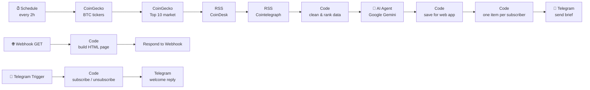

# 🤖 AI Crypto Market Agent

An automated AI agent built with **n8n** and **Google Gemini** that monitors the crypto market every 2 hours. It compares exchanges, reads the latest news and publishes a short market brief to **Telegram subscribers** and a **mobile web app**.

> ⚠️ Educational project. The agent produces automated market information only. It never gives buy/sell orders and is **not financial advice**.

---

## ✨ Features

- **Exchange comparison**: fetches BTC prices from 50 exchanges (CoinGecko) and ranks them by bid-ask spread, then by trading volume
- **Market overview**: top 10 cryptocurrencies with 1h / 24h / 7d price changes
- **News analysis**: reads the last 12 hours of CoinDesk and Cointelegraph RSS feeds and flags news likely to move the market (positive / negative / neutral)
- **AI market brief**: Google Gemini writes a concise summary in French (best exchange, trend, key news, risk level), using only the data provided
- **Telegram bot with subscriptions**: anyone can press **Start** to subscribe and `/stop` to unsubscribe
- **Mobile web app**: a dark, mobile-first page served by n8n that shows the latest analysis and can be added to the phone home screen

---

## 🏗️ Architecture

The workflow has **three independent flows**:

| Flow | Trigger | Role |
|---|---|---|
| Market analysis | Schedule (every 2h) | Collects data, runs the AI analysis, saves it and sends it to subscribers |
| Web app | Webhook (GET) | Returns the HTML page with the latest saved analysis |
| Subscriptions | Telegram Trigger | Registers or removes subscribers and sends a confirmation |

The latest analysis and the subscriber list are stored in the workflow's **static data** (`$getWorkflowStaticData`), so no external database is needed.

---

## 🧰 Tech stack

| Area | Tools |
|---|---|
| Automation | n8n (Schedule, Code, Webhook, Respond to Webhook, RSS Read nodes) |
| AI | Google Gemini via n8n AI Agent (LangChain) |
| Data sources | CoinGecko API, CoinDesk RSS, Cointelegraph RSS |
| Delivery | Telegram Bot API, HTML/CSS web app |
| Language | JavaScript (n8n Code nodes) |

---

## 📸 Screenshots

| Workflow | Telegram brief | Web app |
|---|---|---|
|  |  |  |

---

## 🚀 Setup

### 1. Requirements
- An n8n instance (n8n Cloud or self-hosted with Docker)
- A Google Gemini API key ([Google AI Studio](https://aistudio.google.com/apikey))
- A Telegram bot token (create one with [@BotFather](https://t.me/BotFather))

### 2. Import the workflow
1. In n8n, create a new workflow
2. Open `workflow/ai-crypto-market-agent.json`, copy its content and paste it into the n8n canvas (`Ctrl+V`), or use **Import from File**

### 3. Configure credentials
- **Gemini** node: add your Google Gemini API credential and pick an available *Flash* model
- **Envoyer sur Telegram**, **Bot – nouveau message** and **Répondre à l'abonné** nodes: add your Telegram credential

### 4. Set your default subscriber
In the **Inscrire l'abonné** and **Préparer l'envoi aux abonnés** Code nodes, replace `YOUR_TELEGRAM_CHAT_ID` with your own Telegram chat ID (you can get it from [@userinfobot](https://t.me/userinfobot)).

### 5. Publish
Click **Publish**. Then:
- Web app: `https://<your-instance>/webhook/farah-crypto`
- Telegram: share `https://t.me/<your_bot_username>` so people can subscribe

> The web app shows "first analysis in progress" until the first scheduled run. Static data is only saved during production executions, not manual test runs.

---

## 🔒 Security notes

- No API keys or tokens are stored in this repository. Credentials are managed by n8n.
- Never commit your Gemini key or Telegram bot token. If one is exposed, revoke it (`/revoke` in BotFather, delete the key in Google AI Studio).

---

## 🛣️ Possible improvements

- Add exchange fees and regulatory status to the comparison (spread alone is not the full cost)
- Store history in a database to show trends over time
- Let subscribers choose which coins to follow
- Add retry on failure and an error-notification workflow

---

## 👩‍💻 Author

**Farah Maalaoui** · [LinkedIn](https://www.linkedin.com/in/farah-maalaoui/)

## 📄 License

MIT. See [LICENSE](LICENSE).
